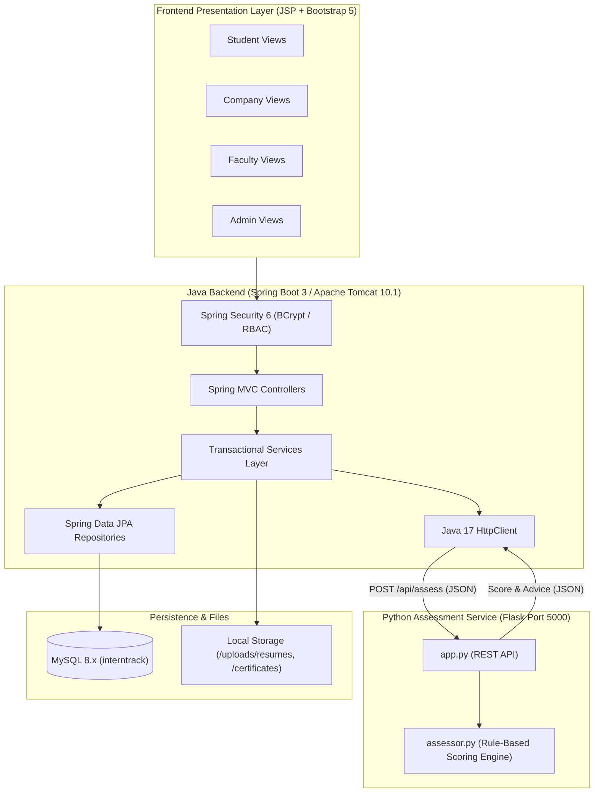
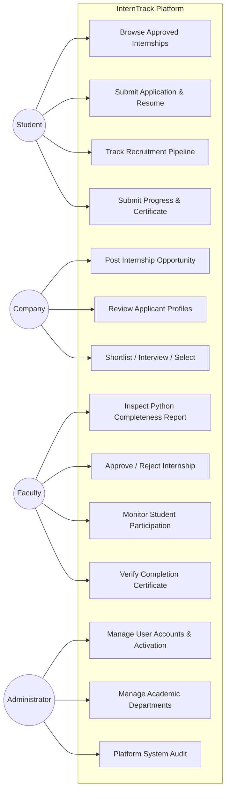
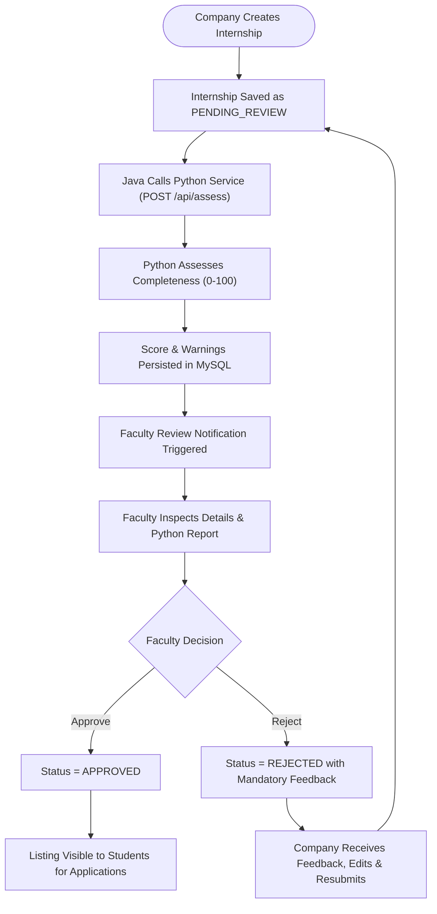
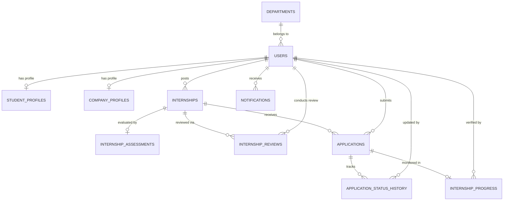

# InternTrack – College-Integrated Internship Management System

A production-grade, database-driven web application designed for academic evaluation (B.Tech Computer Science and Engineering Final Year Capstone Project).

InternTrack establishes a quality-controlled ecosystem connecting **Students**, **Companies**, and **College Faculty** under **Administrative** oversight.

---

## 1. Project Overview & Concept

In traditional college internship processes, internship postings often lack structured quality control, while student applications and academic verifications are decentralized across emails and paper forms.

**InternTrack** resolves this by enforcing an essential intermediary workflow:
1. **Companies** register and post internship listings.
2. Listings **do not** automatically become visible to students.
3. A decoupled **Python Flask microservice** evaluates listing completeness across 8 dimensions (100-point rubric).
4. **College Faculty** acts as the quality-control authority, reviewing the proposal alongside the Python assessment report, and makes the accreditation decision (**Approve** or **Reject** with revision guidance).
5. Once approved, **Students** discover vetted opportunities, filter by skills, department, stipend, and apply.
6. **Companies** review applicants, shortlist, schedule interviews, and make hiring decisions.
7. Selected students log periodic progress and submit completion certificates.
8. **Faculty** verifies completion records for academic credit compliance.
9. **Admin** manages departments, user account activations, and platform audits.

---

## 2. Technology Stack

| Layer | Technologies |
|---|---|
| **Frontend** | JSP (JavaServer Pages), JSTL, HTML5, CSS3, Bootstrap 5.3, Bootstrap Icons, JavaScript |
| **Backend Framework** | Java 17, Spring Boot 3.4.x / 3.5.x, Spring MVC, Spring Security 6, Spring Data JPA, Hibernate 6 |
| **Database** | MySQL 8.x (InnoDB, utf8mb4) |
| **Microservice** | Python 3.11+, Flask 3.x, Flask-CORS, REST API |
| **Packaging & Server** | WAR Packaging (`<packaging>war</packaging>`), Apache Tomcat 10.1 (embedded & standalone compatible) |
| **Build & Tooling** | Apache Maven 3.9+, Eclipse IDE / VS Code / IntelliJ IDEA, MySQL Workbench |

---

## 3. System Diagrams

### 3.1 System Architecture Diagram



### 3.2 Platform Use-Case Diagram



### 3.3 Internship Approval Workflow



### 3.4 Entity-Relationship (ER) Diagram



---

## 4. Project Folder Structure

```
InternTrack/
├── java-backend/
│   ├── pom.xml
│   ├── src/main/java/com/interntrack/
│   │   ├── config/               # WebMvcConfig, DataInitializer
│   │   ├── controller/           # Home, Student, Company, Faculty, Admin controllers
│   │   ├── service/              # User, Department, Internship, Application, Progress, Assessment, Notification
│   │   ├── repository/           # 11 Spring Data JPA Repositories
│   │   ├── model/                # 11 JPA Entities + 5 Enums
│   │   ├── dto/                  # AssessmentResponseDto
│   │   ├── security/             # SecurityConfig, CustomUserDetails, SuccessHandler
│   │   ├── util/                 # SecurityUtils
│   │   └── InternTrackApplication.java
│   ├── src/main/resources/
│   │   └── application.properties
│   └── src/main/webapp/
│       ├── WEB-INF/views/
│       │   ├── common/           # header, footer, sidebar, landing, login, register, notifications, access-denied
│       │   ├── student/          # dashboard, profile, internships, internship-details, applications, progress
│       │   ├── company/          # dashboard, profile, internships, internship-create, internship-edit, applicants
│       │   ├── faculty/          # dashboard, reviews, review-detail, review-history, students, progress, reports
│       │   └── admin/            # dashboard, users, departments, internships, applications
│       ├── css/style.css
│       └── js/main.js
├── python-service/
│   ├── app.py                   # Flask REST API server (port 5000)
│   ├── assessor.py              # Rule-based completeness scoring engine
│   └── requirements.txt
├── database/
│   ├── schema.sql               # MySQL 8.x schema
│   └── sample-data.sql          # Seed dataset with pre-hashed BCrypt demo accounts
├── docs/
│   ├── architecture.md
│   ├── database-design.md
│   ├── api-documentation.md
│   └── testing.md
├── uploads/                     # Upload directory for resumes and completion certificates
├── test_workflows.py            # Automated end-to-end integration test runner
└── README.md
```

---

## 5. Prerequisites & Environment Setup

### 5.1 Java 17 Setup
Ensure OpenJDK 17 or Eclipse Temurin 17 is installed:
```powershell
java -version
```
Set `JAVA_HOME` environment variable to your JDK path (e.g. `C:\Program Files\Eclipse Adoptium\jdk-17.*`).

### 5.2 Maven Setup
Verify Apache Maven 3.9+:
```powershell
mvn -version
```

### 5.3 MySQL 8.x Setup
1. Start your MySQL Server daemon or Windows service.
2. Log in using MySQL CLI or MySQL Workbench:
```sql
CREATE DATABASE IF NOT EXISTS interntrack CHARACTER SET utf8mb4 COLLATE utf8mb4_unicode_ci;
```
3. Initialize the schema and demo sample data:
```powershell
mysql -u root -p interntrack < database/schema.sql
mysql -u root -p interntrack < database/sample-data.sql
```

### 5.4 Python 3.11+ Microservice Setup
Navigate to the `python-service/` directory and install dependencies:
```powershell
cd python-service
python -m pip install -r requirements.txt
```
Run the Python Flask microservice on port 5000:
```powershell
python app.py
```
Verify the health endpoint:
```powershell
curl http://127.0.0.1:5000/api/health
```

---

## 6. How to Build & Run the Java Application

### 6.1 Using Maven (Command Line)
In `InternTrack/java-backend`:
```powershell
cd java-backend
mvn clean package -DskipTests
```
Run the generated WAR archive using the embedded Tomcat container:
```powershell
java -jar target/interntrack.war
```
The application will start on **`http://localhost:8080`**.

### 6.2 Using Eclipse IDE
1. Open Eclipse IDE (Eclipse IDE for Enterprise Java and Web Developers).
2. Choose **File** &rarr; **Import...** &rarr; **Maven** &rarr; **Existing Maven Projects**.
3. Select the folder `InternTrack/java-backend`.
4. Right-click on the project &rarr; **Run As** &rarr; **Spring Boot App** (or configure **Apache Tomcat 10.1 Server** in the Servers tab and add `interntrack`).

---

## 7. Demo Accounts & Credentials

All test accounts are pre-seeded in the database with default password: `password123`.

| Role | Email Address | Password | Redirection Dashboard |
|---|---|---|---|
| **ADMIN** | `admin@interntrack.edu` | `password123` | `/admin/dashboard` |
| **FACULTY** | `faculty.cse@interntrack.edu` | `password123` | `/faculty/dashboard` |
| **FACULTY (IT)** | `faculty.it@interntrack.edu` | `password123` | `/faculty/dashboard` |
| **COMPANY** | `hr@technova.com` | `password123` | `/company/dashboard` |
| **COMPANY** | `careers@apexcloud.io` | `password123` | `/company/dashboard` |
| **STUDENT** | `alex.rivera@student.edu` | `password123` | `/student/dashboard` |
| **STUDENT** | `priya.sharma@student.edu` | `password123` | `/student/dashboard` |

---

## 8. How to Demonstrate the Complete End-to-End Workflow

Follow this step-by-step walkthrough for an academic evaluation or demonstration:

1. **Company Posts Opportunity**:
   - Log in as `hr@technova.com` / `password123`.
   - Go to **Post New Internship**.
   - Enter title: `"Senior Cloud Architecture Intern"`, skills, duration, stipend, and mentorship structure.
   - Click **Submit**. Notice the listing immediately receives `PENDING_REVIEW` and a high Python completeness score.
2. **Faculty Reviews & Quality Checks**:
   - Log out and log in as `faculty.cse@interntrack.edu` / `password123`.
   - Navigate to the **Pending Review Queue**.
   - Click **Review Listing** on the newly posted opportunity.
   - Inspect the **Python Microservice Completeness Assessment Report** displaying the 100-point score, missing sections, and advice.
   - Click **Approve Internship**.
3. **Student Discovers & Applies**:
   - Log in as `alex.rivera@student.edu` / `password123`.
   - Go to **Browse Internships**. Notice the newly approved internship is now visible in the catalog.
   - Click **View Details & Apply** &rarr; **Apply Now**.
   - Attempt to click apply again to demonstrate **Duplicate Application Prevention**.
4. **Company Recruits & Selects Candidate**:
   - Switch back to `hr@technova.com`.
   - Open **Manage Applicants**. Alex Rivera's application appears.
   - Click **Update Status** &rarr; transition to `SHORTLISTED`, and then to `SELECTED` with notes.
5. **Student Submits Progress & Certificate**:
   - Switch back to `alex.rivera@student.edu`.
   - Navigate to **Progress & Completion**.
   - The selected internship now allows submitting sprint contributions and uploading a certificate.
6. **Faculty Verifies Completion for Academic Credits**:
   - Switch back to `faculty.cse@interntrack.edu`.
   - Open **Completion Verification**. Click **Verify** to award academic accreditation.
7. **Admin Platform Overview**:
   - Log in as `admin@interntrack.edu`.
   - Check system-wide health, view all registered students/companies, and audit departments.

---

## 9. Automated Integration Testing

Run the included verification suite:
```powershell
python test_workflows.py
```
This tests all 10 integration phases with a 100% pass rate.
