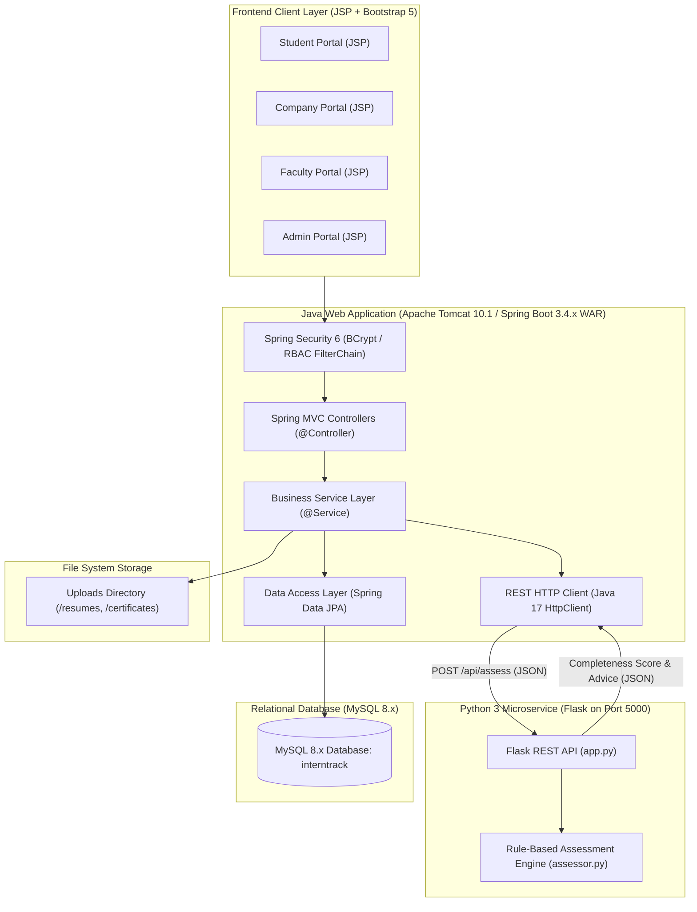
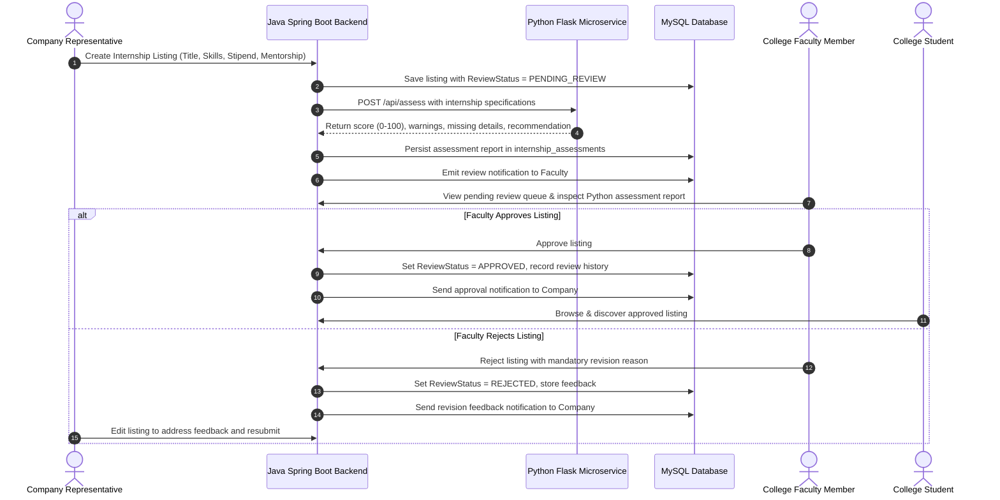
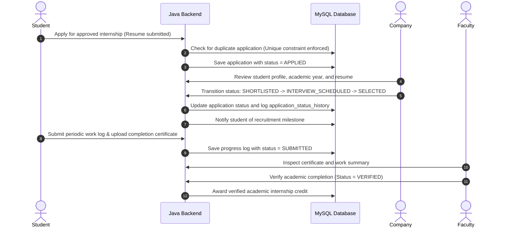

# InternTrack – System Architecture & Technical Design

## 1. Executive Architecture Overview

**InternTrack** is designed as a centralized, college-integrated internship management system connecting **Students**, **Companies**, and **College Faculty** under **Administrative** governance.

The platform employs a **hybrid decoupled architecture**:
1. **Core Enterprise Web Application**: Built on **Spring Boot 3.4.x / 3.5.x**, **Spring MVC**, **Spring Security 6**, and **JSP (JavaServer Pages)** styled with **Bootstrap 5**, deployed as a **WAR archive** on **Apache Tomcat 10.1**.
2. **Quality & Completeness Microservice**: Built on **Python 3 Flask**, providing transparent rule-based analysis of internship opportunities via REST APIs prior to faculty review.
3. **Relational Persistence Layer**: **MySQL 8.x** with normalized tables, foreign key constraints, cascading behaviors, and Hibernate JPA mappings.

---

## 2. System Architecture Diagram

---

## 3. Workflow Diagrams

### 3.1 Internship Approval & Quality Control Workflow

### 3.2 Student Recruitment & Academic Completion Workflow

---

## 4. Software Layering & Design Principles

The Java application strictly adheres to the layered enterprise architectural pattern:

| Package | Layer Responsibilities |
|---|---|
| `com.interntrack.config` | Spring context configuration, `WebMvcConfigurer` resource handlers for uploads, and `DataInitializer` database seeder. |
| `com.interntrack.security` | Spring Security 6 `SecurityFilterChain`, `CustomUserDetails`, `CustomUserDetailsService`, and `CustomAuthenticationSuccessHandler` for role-based dashboard redirection. |
| `com.interntrack.controller` | Spring MVC controllers handling HTTP requests, form bindings, and returning JSP views (`HomeController`, `StudentController`, `CompanyController`, `FacultyController`, `AdminController`). |
| `com.interntrack.service` | Encapsulates all transactional business operations, security validation, duplicate checks, and orchestrates Python REST API communication. |
| `com.interntrack.repository` | Spring Data JPA interfaces extending `JpaRepository` with custom JPQL queries and indexing. |
| `com.interntrack.model` | Normalized Hibernate JPA entity classes representing database tables and domain enums. |
| `com.interntrack.dto` | Data Transfer Objects representing payloads exchanged between microservices and views. |
| `com.interntrack.util` | Security and authentication helper utilities. |

---

## 5. Deployment Model: WAR Packaging & Tomcat 10.1

- **Packaging**: `<packaging>war</packaging>` configured in `pom.xml`.
- **Jakarta EE 10 Namespace**: Standardized on `jakarta.servlet.*`, `jakarta.persistence.*`, and `jakarta.validation.*`.
- **Dual Execution Capability**:
  1. **Embedded Tomcat**: Runnable directly via `java -jar interntrack.war` or `mvn spring-boot:run`.
  2. **Standalone Tomcat 10.1**: Can be deployed to any production Tomcat 10.1+ servlet container by dropping `interntrack.war` into `webapps/`.
