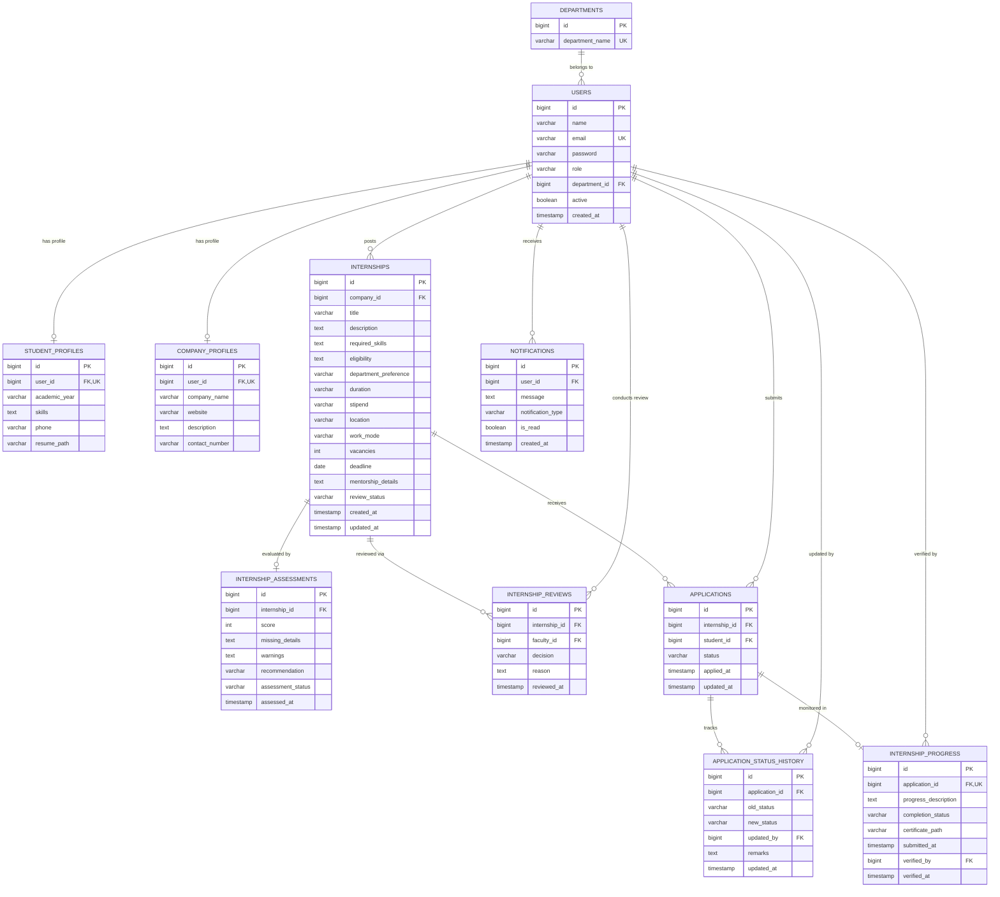

# InternTrack – Database Design & Schema Documentation

## 1. Database Overview

- **Database Engine**: MySQL 8.x
- **Database Name**: `interntrack`
- **Default Character Set**: `utf8mb4`
- **Collation**: `utf8mb4_unicode_ci`
- **Storage Engine**: `InnoDB` (Supporting ACID transactions, foreign key constraints, and row-level locking)

---

## 2. Entity-Relationship (ER) Diagram

---

## 3. Detailed Data Dictionary

### 3.1 `departments` Table
| Column | Type | Constraints | Description |
|---|---|---|---|
| `id` | BIGINT | PRIMARY KEY, AUTO_INCREMENT | Unique department identifier |
| `department_name` | VARCHAR(100) | NOT NULL, UNIQUE | Academic department name (e.g. CSE, IT) |

### 3.2 `users` Table
| Column | Type | Constraints | Description |
|---|---|---|---|
| `id` | BIGINT | PRIMARY KEY, AUTO_INCREMENT | Unique user identifier |
| `name` | VARCHAR(100) | NOT NULL | User's full display name |
| `email` | VARCHAR(150) | NOT NULL, UNIQUE | Login credential & email address |
| `password` | VARCHAR(255) | NOT NULL | BCrypt hashed password (10 rounds) |
| `role` | VARCHAR(20) | NOT NULL | Role: `STUDENT`, `COMPANY`, `FACULTY`, `ADMIN` |
| `department_id` | BIGINT | FOREIGN KEY (`departments.id`) | Department affiliation (for student/faculty) |
| `active` | BOOLEAN | DEFAULT TRUE | Account state (can be deactivated by admin) |
| `created_at` | TIMESTAMP | DEFAULT CURRENT_TIMESTAMP | Account creation timestamp |

### 3.3 `student_profiles` Table
| Column | Type | Constraints | Description |
|---|---|---|---|
| `id` | BIGINT | PRIMARY KEY, AUTO_INCREMENT | Profile record ID |
| `user_id` | BIGINT | NOT NULL, UNIQUE, FK (`users.id`) ON DELETE CASCADE | Associated student user |
| `academic_year` | VARCHAR(50) | NULL | Academic standing (e.g. Final Year) |
| `skills` | TEXT | NULL | Comma-delimited list of technical skills |
| `phone` | VARCHAR(25) | NULL | Contact phone number |
| `resume_path` | VARCHAR(255) | NULL | Relative path to stored resume file |

### 3.4 `company_profiles` Table
| Column | Type | Constraints | Description |
|---|---|---|---|
| `id` | BIGINT | PRIMARY KEY, AUTO_INCREMENT | Profile record ID |
| `user_id` | BIGINT | NOT NULL, UNIQUE, FK (`users.id`) ON DELETE CASCADE | Associated company user |
| `company_name` | VARCHAR(150) | NOT NULL | Legal/Commercial enterprise name |
| `website` | VARCHAR(200) | NULL | Corporate website URL |
| `description` | TEXT | NULL | Company overview & business description |
| `contact_number` | VARCHAR(25) | NULL | Enterprise recruitment contact |

### 3.5 `internships` Table
| Column | Type | Constraints | Description |
|---|---|---|---|
| `id` | BIGINT | PRIMARY KEY, AUTO_INCREMENT | Internship opportunity ID |
| `company_id` | BIGINT | NOT NULL, FK (`users.id`) ON DELETE CASCADE | Posting enterprise |
| `title` | VARCHAR(200) | NOT NULL | Role title |
| `description` | TEXT | NOT NULL | Comprehensive job & project scope |
| `required_skills` | TEXT | NOT NULL | Technical & soft skill prerequisites |
| `eligibility` | TEXT | NULL | Degree, batch, and CGPA requirements |
| `department_preference`| VARCHAR(100) | NULL | Target engineering department |
| `duration` | VARCHAR(50) | NOT NULL | Duration (e.g. '3 Months') |
| `stipend` | VARCHAR(50) | NOT NULL | Compensation amount |
| `location` | VARCHAR(100) | NOT NULL | Office city or location |
| `work_mode` | VARCHAR(30) | NOT NULL | `ON_SITE`, `REMOTE`, `HYBRID` |
| `vacancies` | INT | DEFAULT 1 | Number of open positions |
| `deadline` | DATE | NULL | Application cutoff date |
| `mentorship_details` | TEXT | NULL | Reporting mentor & review details |
| `review_status` | VARCHAR(30) | NOT NULL | `PENDING_REVIEW`, `APPROVED`, `REJECTED`, `CLOSED` |
| `created_at` | TIMESTAMP | DEFAULT CURRENT_TIMESTAMP | Submission timestamp |
| `updated_at` | TIMESTAMP | DEFAULT CURRENT_TIMESTAMP ON UPDATE | Last modification timestamp |

### 3.6 `internship_assessments` Table
| Column | Type | Constraints | Description |
|---|---|---|---|
| `id` | BIGINT | PRIMARY KEY, AUTO_INCREMENT | Assessment ID |
| `internship_id` | BIGINT | NOT NULL, FK (`internships.id`) ON DELETE CASCADE | Target listing evaluated |
| `score` | INT | NOT NULL | Completeness score (0 to 100) |
| `missing_details` | TEXT | NULL | Delimited missing components |
| `warnings` | TEXT | NULL | Identified policy warnings |
| `recommendation` | VARCHAR(255) | NULL | Recommendation advice for faculty |
| `assessment_status` | VARCHAR(30) | DEFAULT 'SUCCESS' | `SUCCESS`, `FAILED`, `MANUAL_REVIEW_REQUIRED` |
| `assessed_at` | TIMESTAMP | DEFAULT CURRENT_TIMESTAMP | Execution timestamp |

### 3.7 `internship_reviews` Table
| Column | Type | Constraints | Description |
|---|---|---|---|
| `id` | BIGINT | PRIMARY KEY, AUTO_INCREMENT | Review entry ID |
| `internship_id` | BIGINT | NOT NULL, FK (`internships.id`) ON DELETE CASCADE | Evaluated listing |
| `faculty_id` | BIGINT | NOT NULL, FK (`users.id`) | Reviewing faculty member |
| `decision` | VARCHAR(30) | NOT NULL | `APPROVED`, `REJECTED` |
| `reason` | TEXT | NULL | Constructive feedback or approval notes |
| `reviewed_at` | TIMESTAMP | DEFAULT CURRENT_TIMESTAMP | Review timestamp |

### 3.8 `applications` Table
| Column | Type | Constraints | Description |
|---|---|---|---|
| `id` | BIGINT | PRIMARY KEY, AUTO_INCREMENT | Application identifier |
| `internship_id` | BIGINT | NOT NULL, FK (`internships.id`) ON DELETE CASCADE | Applied internship |
| `student_id` | BIGINT | NOT NULL, FK (`users.id`) ON DELETE CASCADE | Applying student |
| `status` | VARCHAR(30) | NOT NULL | `APPLIED`, `UNDER_REVIEW`, `SHORTLISTED`, `INTERVIEW_SCHEDULED`, `SELECTED`, `REJECTED` |
| `applied_at` | TIMESTAMP | DEFAULT CURRENT_TIMESTAMP | Application submission timestamp |
| `updated_at` | TIMESTAMP | DEFAULT CURRENT_TIMESTAMP ON UPDATE | Last status transition timestamp |
| *(Composite Key)* | - | `UNIQUE (student_id, internship_id)` | Prevents duplicate applications |

### 3.9 `application_status_history` Table
| Column | Type | Constraints | Description |
|---|---|---|---|
| `id` | BIGINT | PRIMARY KEY, AUTO_INCREMENT | Audit log ID |
| `application_id` | BIGINT | NOT NULL, FK (`applications.id`) ON DELETE CASCADE | Associated application |
| `old_status` | VARCHAR(30) | NULL | Previous status |
| `new_status` | VARCHAR(30) | NOT NULL | Updated status |
| `updated_by` | BIGINT | NOT NULL, FK (`users.id`) | User who performed transition |
| `remarks` | TEXT | NULL | Interview link, feedback, or decision remarks |
| `updated_at` | TIMESTAMP | DEFAULT CURRENT_TIMESTAMP | Status update timestamp |

### 3.10 `internship_progress` Table
| Column | Type | Constraints | Description |
|---|---|---|---|
| `id` | BIGINT | PRIMARY KEY, AUTO_INCREMENT | Progress log ID |
| `application_id` | BIGINT | NOT NULL, UNIQUE, FK (`applications.id`) ON DELETE CASCADE | Associated selected application |
| `progress_description`| TEXT | NULL | Student's sprint work summary |
| `completion_status` | VARCHAR(30) | NOT NULL | `NOT_STARTED`, `IN_PROGRESS`, `SUBMITTED`, `VERIFIED`, `COMPLETION_REJECTED` |
| `certificate_path` | VARCHAR(255) | NULL | File path to completion certificate |
| `submitted_at` | TIMESTAMP | NULL | Certificate submission timestamp |
| `verified_by` | BIGINT | NULL, FK (`users.id`) | Faculty member who certified completion |
| `verified_at` | TIMESTAMP | NULL | Verification timestamp |

### 3.11 `notifications` Table
| Column | Type | Constraints | Description |
|---|---|---|---|
| `id` | BIGINT | PRIMARY KEY, AUTO_INCREMENT | Notification ID |
| `user_id` | BIGINT | NOT NULL, FK (`users.id`) ON DELETE CASCADE | Recipient user |
| `message` | TEXT | NOT NULL | Notification content |
| `notification_type` | VARCHAR(50) | NULL | Notification category |
| `is_read` | BOOLEAN | DEFAULT FALSE | Read/Unread flag |
| `created_at` | TIMESTAMP | DEFAULT CURRENT_TIMESTAMP | Emission timestamp |

---

## 4. Key Performance Indexes
- `idx_users_email` ON `users(email)`
- `idx_users_role` ON `users(role)`
- `idx_internships_review_status` ON `internships(review_status)`
- `idx_applications_status` ON `applications(status)`
- `idx_notifications_user_read` ON `notifications(user_id, is_read)`
